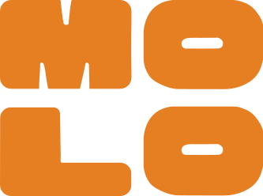

<div align="center">
    
    <h2>molo backend</h2>
    <p>Local news and events, collected and curated in one place</p>

[](https://www.repostatus.org/#active)


</div>

### Quick links

- 🚀 Install and run your own instance: [docs/installation.md](docs/installation.md)
- ⚙️ Configuration reference: [docs/configuration.md](docs/configuration.md)
- 🤖 Local AI features (Ollama, gpt-oss): [docs/ai.md](docs/ai.md)
- 📥 Importing articles and events: [docs/importing.md](docs/importing.md)
- 🔌 REST API: [docs/api.md](docs/api.md)
- 🔒 Privacy and data handling: [docs/privacy.md](docs/privacy.md)
- 🤝 Contributing: [CONTRIBUTING.md](CONTRIBUTING.md)

## What is molo?

molo is a free/libre Open Source platform for local information. It collects news
and events from many local sources – newspapers, municipalities, cultural venues,
clubs and initiatives – and makes them available in one place, sorted by region and
topic. Organizations and citizens can also publish their own articles and events.

It's developed by the [ZeMKI (Centre for Media, Communication and Information Research)](https://zemki.uni-bremen.de/)
at the [University of Bremen](https://www.uni-bremen.de/).

This repository contains the **backend**: a Django application that provides

- **Import pipelines** for RSS/Atom, JSON, XML and iCalendar feeds, plus
  AI-generated scrapers for websites without a feed
- **Duplicate detection** across sources with source priorities
- **Editorial interface** (`newadmin`) for articles, events, organizations and statistics,
  plus the classic Django admin
- **REST API** (v1–v4, OpenAPI/Swagger) for the mobile apps and web clients
- **Regions and topics**: areas (postal codes / towns), tags, subtags and categories
- **AI features that run entirely on your own hardware** via [Ollama](https://ollama.com)
  with the open-weight model [gpt-oss](https://ollama.com/library/gpt-oss) (20b or 120b):
  natural-language event search, tagging, scraper generation and date recognition
- Optional **push notifications**, **monitoring** and **statistics**

No data is sent to commercial AI cloud services.

## Getting started

```bash
git clone https://github.com/zemki/molonews-django-backend.git molo && cd molo
python3.12 -m venv .venv && source .venv/bin/activate
pip install -r requirements.txt
cp .env.example .env          # set DB_* and DJANGO_SECRET_KEY
python manage.py migrate
python manage.py createcachetable
python manage.py createsuperuser
python manage.py runserver
```

The editorial interface is then available at http://localhost:8000/ and the API
documentation at http://localhost:8000/api/v4/swagger/.

For the AI features, install [Ollama](https://ollama.com) and pull the model:

```bash
ollama pull gpt-oss:20b
```

See [docs/installation.md](docs/installation.md) for a complete setup including
PostgreSQL, production deployment (gunicorn, nginx, systemd) and scheduled jobs.

## Project structure

```
molo/        Django project: settings, URLs, WSGI/Celery, local LLM client (llm.py)
content/     Data model, admin, import tools and management commands
api/         REST API (v1–v4), tagging endpoints for external workers
newadmin/    Editorial web interface
rag/         Natural-language event search
locale/      Translations
deploy/      Example configuration for nginx, systemd and cron
scripts/     Helper scripts (manage.py wrapper, database backup)
docs/        Documentation
```

## Development

If you have reached this section, chances are high you want to

- run molo on your own infrastructure,
- understand molo or hack on a local version,
- improve molo.

Start with [docs/installation.md](docs/installation.md) and [CONTRIBUTING.md](CONTRIBUTING.md).
Please report security issues privately to [kontakt@molo.news](mailto:kontakt@molo.news)
or via GitHub's private vulnerability reporting, not as public issues.

## Contact

Questions, feedback or interest in running molo in your region:
[kontakt@molo.news](mailto:kontakt@molo.news)

## Licenses

### Software

molo is a free/libre Open Source Software for local news and events.
Copyright (C) 2026 ZeMKI, Universität Bremen

The software is released under the AGPL-3.0 license, which you can read in our
[license file](./LICENSE). If you run a modified version of molo as a network
service, you must make the source code of your version available to its users.

### Third-party components

Bundled third-party JavaScript and CSS (jQuery, Bootstrap Datepicker, Tom Select,
jquery-modal) keep their own licenses as stated in the respective files.
